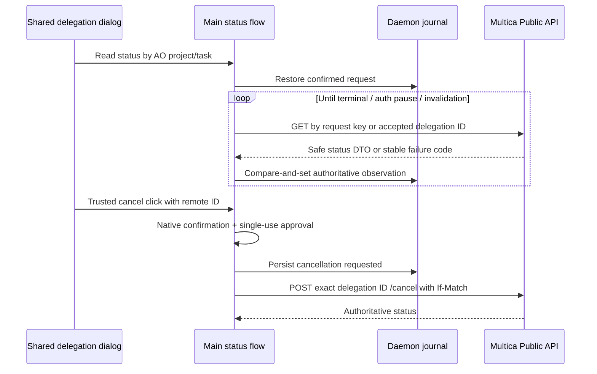

# Confirmed Multica delegation coordinator

The desktop session controls are hidden by default. Enable **Experimental: software factory controls**
in **Settings → General → Advanced** to show **Run evidence** and **Delegate to Multica**
for eligible local worker and project orchestrator sessions. The `factoryControlsEnabled` boolean
is saved with the other app preferences in `ui-settings.json` under the AO state directory.
Turning it off closes these panels and dialogs; existing run evidence, delegation data, and APIs are preserved.

`frontend/src/main/multica-delegation-coordinator.ts` provides one main-process
coordinator to task and project orchestrators. Both handles refer to the same
instance, share serialization, and use the same task identity and journal.
The desktop's shared preview/confirmation flow (TK-MA66) is the only dispatch
entry point. Assignment/status events and automation have no dispatch or
confirmation entry point. Admission defaults off, including in the desktop. The
user must first enable Confirmed delegation in Settings (saved across restarts); the preview and native approval are still required for each send. The
server's rollout gate is independent.

Construct it with `createDaemonDelegationJournal`, a trusted daemon-origin
callback, the private main-process authority, and a resolver returning TK-MA63
connections for configured bindings.
The resolver must use configured connections, never connection data from task
text. The coordinator compares all connection binding fields before use. Tokens
stay in the existing main-process Public API client; they never enter the journal.

The private `human.confirmFromUserAction` entry point takes the exact previewed binding and payload
and an approval ID, user identity and timestamp captured by the trusted user
interaction. It persists these together with the canonical server origin/key,
workspace/profile/runtime IDs, AO project/task IDs, payload digest and generated
request ID. This records what the user approved. It performs no admission.
`process` and `processTask` can read/reconcile only this persisted confirmation.
Admission through `process` additionally requires the main-only live preview
guard; `processTask` cannot send.

The digest is SHA-256 over the seven ordered wire-payload string fields
(profile, expected runtime, source system/project/task, title, instructions),
each prefixed by its UTF-8 byte length and a colon. This keeps the Go/TypeScript
boundary independent of JSON key order, HTML escaping, and Unicode escaping.
Binding and approval fields are immutable separately from the payload digest.
The coordinator and daemon both verify the payload before processing.

`backend/internal/storage/sqlite/migrations/0218_multica_delegations.sql` adds the
request journal, a unique current request per project/task, unique confirmation
IDs, and an append-only transition history with timestamps and record snapshots.
Reservation, replacing a task's current request for a confirmed rerun, and
transition recording are transactional. Updates compare the persisted version;
a stale writer fails and must reload. Intent and attempt markers commit before
any remote admission. The daemon owns SQLite; the desktop never opens its DB.
The private `/internal/multica-delegation-journal` endpoint requires a HMAC over
the exact request body, including operation and record version, in addition to
local-control and LAN-listener guards. Every request includes a fresh nonce;
successful responses are separately HMAC-authenticated and bound to that request,
so a rogue loopback server cannot invent a confirmed journal record or replay an
old response. Response size is bounded. It has no confirmation issuer. Reserve
only commits a main-process-minted per-intent proof: a second purpose-separated
HMAC binds the stable intent/request ID nonce, principal, time, rerun predecessor, exact target
tuple and payload hash. Neither a valid-looking record nor a loopback Host can
create confirmation. Proofs and MAC keys are never returned in journal DTOs.

Electron generates a fresh 32-byte key in memory and delivers it through the
existing private daemon-stdin handoff alongside the browser token. The key is
never in environment variables, CLI args, settings, run files, or sessions.
The daemon does not inherit this consumed pipe into workers. Legacy/headless
launches have no authority and reject all journal calls. Attaching a new desktop
to an already running daemon cannot enroll a replacement key through HTTP;
this capability remains unavailable until a newly paired daemon is launched.
No UI/IPC/MCP route exposes the authority or the `human` handle. Task and project
handles expose only processing/reconciliation. The desktop invokes the private
human API only from its validated explicit user-action flow.

Migration `0219_multica_confirmation_verification.sql` marks legacy records
unverified by default. Only authenticated, proof-verified reservations set the
provenance fact. Reads/updates never adopt pre-proof records. This durable fact
survives daemon and desktop restarts without persisting the boot key or proof.
Intent, remote projection and cancellation fields are strictly decoded (unknown
fields rejected), checked for secrets as decoded strings, and rebuilt from typed
schemas before persistence, so JSON escape spelling cannot conceal credentials.
It is an internal transport, outside the public daemon OpenAPI contract.

On recovery, an attempted request without remote IDs is looked up by its original
idempotency key. Failed, incomplete or ambiguous lookups cannot trigger a retry.
A successful empty lookup permits replay of the exact approved payload and key
only with another live preview and native approval; it never permits a fresh key. A found record must match the approved workspace,
profile and runtime. Once accepted, status uses its exact delegation ID and task
identity. Revisions are opaque; terminal observations cannot be overwritten.
`unavailable` is nonterminal. Neither polling nor admission changes AO task or
Multica issue status.

A definite rejection on the first admission is retained with its stable failure
code. A failed replay cannot prove an earlier ambiguous admission was rejected.
A changed payload on the same task conflicts, and the coordinator refuses to
process a digest mismatch. Changing the payload or binding requires another
preview and confirmation, expressed as a rerun.

Repeated confirmation/processing of the same task reuses its existing request.
A rerun requires a new approval ID and `rerunOf` naming the current request.
Repeated delivery of that approval returns the same rerun. A stale rerun pointer
conflicts. A rerun is reserved only when the predecessor is terminal or definitively
rejected. Running, queued, unknown, and cancellation-pending predecessors block
reservation atomically, so two independent coordinators cannot replace work
that remains processable. Reconcile or explicitly cancel the predecessor and
observe its terminal outcome first. This API does not implement a "cancel
previous" shortcut; that option must not be offered by a caller. Prior terminal
records remain addressable and can never submit work again.

`human.cancelFromUserAction` persists a separate approval before using the client's cancellation
path. Accepted work stays `cancellation_requested` until an authoritative terminal
observation arrives. Unknown admissions reconcile first; an empty lookup does
not justify submitting a cancelled request. Cancellation before any attempt
closes the local intent without remote admission. Cancellation and status remain
available when local admission is disabled. Lost cancellation responses recover
by status before another cancellation attempt.

Validation covers process and local-write crash windows, recovery, one-current
uniqueness, approval replay, confirmed reruns, immutable payload/approval fields,
version conflicts, terminal retention, cancellation, rollout defaults, and the
private HTTP transport boundary. All databases and journal fixtures use scratch
directories; tests do not use the installed app, live daemon, or credential vault.

The real-journal integration test builds a scratch Go HTTP fixture on an ephemeral
loopback port and drives two independently constructed TypeScript coordinators
against its SQLite store. It checks forged/unsigned HTTP writes, proof binding,
concurrent confirmation/processing, strict schemas, escaped secrets, and the
terminal-predecessor rerun gate. It never launches the actual daemon.

## Optional managed policy (TK-MA65)

The mandatory policy resolver runs before confirmation proofs are minted and at
actual admission send time. The coordinator also checks before recording an
attempt. Local hooks may narrow choices. If a local hook waits, the coordinator
rechecks managed policy after it returns. Admission passes a required private
send guard into the member Public API client; that client invokes it after its
queue, its own local hook, and credential resolution, immediately before HTTP
`fetch`. Missing guards, errors and unknown outcomes block with safe codes.
There is no asynchronous work between the final guard and sending other than the
HTTP request itself. This includes replays of an ambiguous submission.

`createDaemonDelegationJournal` still evaluates policy over the existing signed,
nonce-bound journal route (`evaluatePolicy`). No listener, renderer/preload IPC,
or confirmation issuer is added. Documents stay in the daemon; only a fixed
reason code crosses to main or the existing journal's `failureCode` field.

### Protected enrollment and policy sources

`backend/pkg/agentcreds/delegation_policy_sources.go` uses AO's existing managed
settings locations and document parser, with a stricter trust boundary for
external delegation. On Unix, every source and every ancestor must be root-owned,
non-symlinked, and not group/other writable. On macOS, native extended ACL checks
also reject mutation grants to anyone except root or wheel (gid 0); admin and
staff are not authority. This includes write/append, deletion, child deletion,
attribute/security changes and ownership changes, even for inherited grants.
Denies cannot offset an unsafe allow. For present sources, native ACL lookup, decoding or principal
resolution errors fail closed with `policy_unavailable`; no ACL details leave
the resolver. ACL absence is verified with native security metadata, rather than
treating a failed ACL lookup as absence. macOS builds require cgo to verify ACLs;
without it, managed delegation fails closed with `policy_unavailable`. A macOS
presence pass first checks the known policy files, drop-in directory, enrollment
markers and managed preference plist inventory without reading ACLs or policy
content. Before concluding absence, every standard source/enrollment location's
directory and ancestors must also be root-owned, non-symlinked, and not writable
or deletable by non-root principals. With cgo these checks include native ACLs;
unsafe or unverifiable empty locations return only `policy_location_unsafe`.
Deleting the sole policy from an unsafe directory therefore cannot make the
machine unmanaged. Only protected, empty locations take the personal
`policy_absent` path. Lookup/inventory errors still block, and present sources
must pass all protection checks. Without cgo, empty locations still require root
ownership, safe mode bits and no symlinks, but ACL grants cannot be detected.
This residual ACL risk is limited to no-cgo builds; both shipped macOS desktop
build paths explicitly enable and verify cgo. Legacy
`packages/build-binaries.sh` cross-builds keep cgo disabled: their macOS binaries
permit personal use under those mode checks but block managed-policy delegation.
Linux and Windows retain their existing checks. Files must be regular, open with
`O_NOFOLLOW`, and retain their identity, size and modification time across the
bounded read. Once macOS enrollment is present, missing sources also require
protected ancestors: an editable parent cannot erase enrollment. Unsupported or unsafe ownership, unreadable
sources and uncertain enrollment fail closed. Credential stores are not read, and policy helpers are not executed.

Authoritative policy comes from system `managed-settings.json`, its protected
`managed-settings.d/*.json` drop-ins, or protected machine/current-user Claude
managed preferences on macOS. macOS plist conversion uses the existing system
`plutil` reader only after protection checks; a changed snapshot is rejected.
Other protected machine/current-user managed preference plists and the native
ConfigurationProfiles enrollment markers establish enrollment without reading
their contents. Administrators may also register enrollment with a protected
`ao-managed-enrollment` marker beside the system settings file. Windows uses
machine-registry policy and system files only after owner/DACL validation; user
write access to a source or ancestor makes it unavailable. HKCU is not authority.

Enrollment and policy content are separate. Any protected enrollment with no
valid protected `aoMulticaDelegation` policy returns `policy_unavailable`.
User-writable `remote-settings.json` is restrict-only: allow, replacement, removal,
and empty cache content cannot override protected enrollment or its restrictions.
A cache cannot supply the policy required by enrollment. Only absence of protected
enrollment permits the personal/unmanaged base case (`policy_absent`); explicit
selection, confirmation, rollout, and provider checks remain required.

Every configured policy is a ceiling, including distinct drop-ins and plists;
their intersection applies. The optional `aoMulticaDelegation` object requires
`version: 1`, non-empty `revision`, RFC3339 `validUntil`, and `effect: "allow"` or
`"deny"`. Allow requires explicit `serverOrigins`, `workspaceIds`, `profileIds`,
`runtimeClasses`, `dataScopes`, and `actions` arrays. Every array must match;
empty arrays deny all. Deny needs no allowlists. Unknown/duplicate fields,
unknown versions/effects, malformed content, dynamic helpers and expired policy
are unavailable. Expiry uses the current clock after source loading, with a final
check of the earliest expiry before returning. Local choices cannot widen any
protected ceiling.

### Scope and safe outcomes

Requests contain only canonical origin, workspace/profile/runtime IDs, runtime
class, data scope `task_brief`, and action `delegate`. They exclude task text,
local paths, user identity and credentials. The payload currently supports only
the user-approved task brief; this does not authorize file reads, root sharing
or uploads. New payload scopes require extending approval and policy together.

A trusted main-process `resolveRuntimeClass` must establish `local` or `remote`
for the exact binding/runtime. Location is never inferred from a loopback server
or profile name. Current Public API runtime metadata does not establish location;
without a resolver it is `unknown`. Personal use with no enrollment can proceed;
a managed allow with unknown location returns `policy_runtime_unknown`. Remote
execution must explicitly match every ceiling. Location is resolved afresh for
the final send guard.

Additional main-process policy hooks may only narrow the managed decision. Their
only result is `{code}`: `policy_absent`, `policy_allowed`, `policy_denied`,
`policy_unavailable`, `policy_runtime_unknown`, or `policy_location_unsafe`.
Extra fields, unknown outcomes,
exceptions and five-second evaluation timeouts become `policy_unavailable`.
Source-provided reasons, revisions, policy text and error messages are never
logged, persisted or exposed.

A block before confirmation creates no proof or reservation. A dispatch block
persists its safe reason while leaving the intent pending. After a durable attempt
marker, the conservative `submission_unknown` state remains even if this process
has not sent; processing reconciles the original key before replay. A policy
block never proves an earlier ambiguous admission was rejected. Reconciliation
and explicitly confirmed cancellation remain available. No migration is needed.

## Shared preview and confirmation (TK-MA66)

`MulticaDelegationDialog` is mounted by the local session topbar for task and
project orchestrators. Both use `multica-delegation-confirmation.ts` in main and
the same coordinator instance. Remote/cloud session controls are not routed to
the local coordinator. The user supplies stable workspace/profile/runtime IDs;
the configured server supplies the destination and the Public API supplies the
profile name, invocation/readiness facts and current runtime binding.

Preview is read-only. It shows destination server/key/workspace, profile name/ID,
bound runtime, AO project/task identifiers, title and full brief, the exact scope
and a safe effective-policy source label. The supported scope is only the brief
and source identifiers: no files, roots, attachments or history are read or
uploaded. Member Public API credentials may be explicitly saved for this exact
configured server/workspace through the existing credential store; they are never
included in previews, confirmation results or tokens.

Main stores a private immutable snapshot with a SHA-256 digest over destination,
profile/runtime, source, brief, scope, policy decision and profile label. A
preview expires after two minutes. Editing any field revokes the preview;
changing source props, closing/unmounting the dialog, navigating, changing the
configured connection or saving a credential also invalidates it. Starting any
replacement preview invalidates its predecessor, even if the new preview fails;
overlapping preview reads cannot revive an older generation. A failed or cancelled
confirmation consumes the preview, requiring another review.

Preload exposes preview, revoke, credential-save and result subscription only.
There is no renderer confirm/mint/process method. Its isolated-world listener
forwards only a trusted click with current user activation on the confirmation
button. Main accepts IPC only from the shell's current main frame and requires
focus. Embedded Multica, browser tabs and child frames cannot invoke it. A native
dialog then displays the same exact snapshot, with Cancel selected by default;
only its explicit affirmative response can authorize the handoff. Repeated clicks
while this dialog is open are ignored.

After native approval, main revalidates connection, profile/runtime binding,
permissions/readiness and policy. Policy source changes require another preview;
denials and unknown decisions expose only fixed safe reasons. Only then does main
mint a cryptographically random token, bound to the snapshot hash, valid for at
most ten seconds and never beyond preview expiry. It consumes the token once
before calling the private human coordinator API, which persists the proof-bound
intent. Tokens never cross IPC, enter the journal or become available to CLI,
orchestrator processes, task creation, assignments or status/automation events.
The coordinator carries a synchronous preview-liveness check through its queue,
journal work, client queue and credential resolution. The Public API client runs
that check immediately before calling `fetch`, after the final asynchronous policy
guard, with no intervening await. Edits and closing/cancelling the dialog revoke
cleanly even after native approval while processing is pending. Expiry and main
disposal also block that send. A revoked request returns `confirmation_required`;
its durable attempt marker remains conservative rather than inventing a remote
outcome. Another attempt requires a fresh preview and approval.
The coordinator independently rechecks policy at reservation and actual send;
Multica revalidates runtime binding at admission. A conflict cannot reroute or
retry with a new target without another preview and confirmation.

Tests cover both UI paths, cancelled/expired previews, edits, stale bindings,
policy denial/unknown results and safe reasons, token forgery/replay/hash mismatch,
frame/focus checks, scripted-click rejection and absence of event-driven dispatch.
The native dialog is injected in flow tests; the installed app and live daemon
are not used.

## Status, reconciliation and explicit cancellation (TK-MA67)

`frontend/src/main/multica-delegation-status.ts` owns desktop status polling.
Confirming a request starts monitoring even if the dialog closes. Opening the
shared task/project delegation dialog restores the current request
from the daemon journal by AO project/task identity, including after restart.
Monitoring continues in main until terminal state, connection invalidation or
shell disposal. A fresh dialog read returns the cached narrow projection;
renderer refreshes cannot bypass main's backoff. No CLI or public daemon route
was added.

The coordinator's `reconcile` handle reads only: it looks up an attempted unknown
submission with its original scoped idempotency key, then uses the accepted
remote delegation ID. It never replays admission or issues cancellation. Empty,
paginated and non-unique key lookups remain unknown, with increasing delay.
Polling starts at two seconds and doubles on unsuccessful reads or unresolved
lookups to a sixty-second ceiling. Rate limits respect the client's bounded
Retry-After delay. Reads are serialized with processing/cancellation and use
journal compare-and-set updates. Terminal records stop polling and never regress;
opaque revisions are never numerically or lexically ordered. Active scheduler
states may change in either direction, including deferred and unavailable.

Credential/scope failures pause polling and show reauthentication, preserving the
last authoritative status and request ID. Saving a replacement member credential
for the same workspace resumes checks without creating a new request. Connection
changes stop the old monitor; each poll checks the configured binding before
resolving credentials. No credential, exception, provider problem detail, payload,
result/error text, branch or work directory enters the renderer status DTO.
Only local/remote identity, safe lifecycle state, coarse failure code and
connection health are projected. The journal retains the allow-listed Public API
DTO only. AO task/issue status is never changed by this projection.

Cancellation is available only for an accepted remote delegation ID. The isolated
preload's trusted click/user-activation check requests a focused shell main-frame
IPC action. Main loads the confirmed journal record and displays a native dialog
showing the configured destination and exact remote delegation/task IDs. Native
approval mints and consumes a single-use main-only token bound to that target.
The coordinator rechecks the remote ID and the live confirmation guard, including
a final check after credential resolution and immediately before the HTTP write.
Navigation, server or credential changes, expiry and disposal invalidate pending approval. No token or
private human handle is exposed to the renderer, CLI, events or automation.

The cancellation fact commits before sending. A timeout, revision conflict,
unauthorized response or nonterminal success leaves `cancellation_requested`.
Status checks remain read-only even with that fact present. Retrying cancellation
requires another native user confirmation; orchestrator `process` calls cannot
send a cancellation from the persisted fact alone. A completion race retains
Multica's authoritative completed/failed/cancelled terminal outcome. Reassignment
and AO status events do not request cancellation.

The inspected Multica `origin/main` already implements the three needed operations
in `server/pkg/publicapi/v1/{routes.go,openapi.yaml}` and its public delegation
handlers: `GET /api/v1/delegations?idempotency_key=...`,
`GET /api/v1/delegations/{delegation_id}` and
`POST /api/v1/delegations/{delegation_id}/cancel`. No Multica changes are required
for this AO-side implementation. The server's independent default-off rollout
gate remains in force; no live server or installed application is exercised.

Coverage is in `multica-delegation-status.test.ts`, the coordinator, authority,
confirmation IPC, Public API and real-journal integration suites, and
`renderer/components/MulticaDelegationDialog.test.tsx`.

## Default-off rollout and contract coverage (TK-MA68)

Desktop delegation admission defaults to disabled. Settings → Multica → Confirmed
delegation uses a trusted preload click, a focused main-frame IPC request and a
native enablement dialog. Main serializes and atomically saves the preference
in the existing `multica-settings.json` file. Missing, malformed, nonboolean or
unreadable preferences default off. Connection-setting saves preserve this field
and cannot set it, even if an untyped caller supplies it. The dedicated writer is
used only after main validates the trusted enable action and native approval;
disabling requires no dialog. CLI requests, project/task settings, environment
variables and automation expose no enablement path. Enabling it
does not approve a handoff: every admission, including a retry, needs a current
preview and native approval. Saved confirmations support read-only recovery.
The coordinator requires a live guard for admission, and the client rechecks the
rollout gate immediately before the HTTP write, after credential/policy waits.
Disabling invalidates pending previews and cancellation approvals. Status and
explicitly confirmed cancellation of previously accepted work remain available.

See the [operator checklist](multica-delegation-operator-checklist.md) and
[shared contract verification](multica-delegation-contract.md) for offline and
opt-in handler coverage. No unattended rollout or pilot is included.
